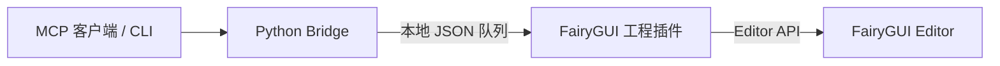

# FairyGUI Agent Bridge

通过 MCP 或 CLI，让 AI 编程助手读取和编辑正在运行的 FairyGUI 工程。

[](https://github.com/Wilson520403/fgui-agent-bridge/actions/workflows/ci.yml)
[](LICENSE)

Bridge 提供组件创建、界面布局、资源管理、动效编辑和发布工具。支持 MCP stdio 的客户端可以调用这些工具；无需 AI 客户端时，也可以直接使用命令行。

**当前版本：0.8.25** · **74 个 MCP 工具** · **主要验证环境：FairyGUI Editor 6.1.4 / macOS**

[快速开始](#快速开始) · [使用示例](#使用示例) · [工具与行为参考](docs/usage.md) · [兼容性](#兼容性与范围) · [参与开发](#参与开发)

## 可以用它做什么

| 工作 | 支持的操作 |
| --- | --- |
| 搭建界面 | 创建组件、按钮、文本、List 和 Loader；插入资源实例；分组、复制和调整层级 |
| 调整布局 | 修改位置、尺寸、文字样式、List/Group 布局、Relation、Controller 和 gearDisplay |
| 管理资源 | 导入图片、字体、声音；缩放大图；改名、移动、复制或删除包内资源 |
| 处理引用 | 查询引用与依赖、替换对象资源或全工程引用、查找未使用及重复资源 |
| 制作动效 | 创建和修改 Transition、编辑关键帧、生成 MovieClip、控制动画预览 |
| 验证与发布 | 保存后读取 XML、关闭重开验证；分析图集约束，发布活动包、指定包或全部包 |

例如，你可以让 Agent「先读取当前组件，在右上角添加一个图片 Loader，再用已有按钮组件创建三项菜单」。Agent 通过工具执行编辑，你可以在 FairyGUI Editor 中检查结果。

## 快速开始

### 环境要求

- Python **3.10+** 和 [uv](https://docs.astral.sh/uv/)。
- 已安装 FairyGUI Editor，并有可打开的 `.fairy` 工程。
- 使用 MCP 时，客户端需要支持 **stdio**，并能访问这台电脑上的 Bridge 和 FairyGUI 工程目录。

本仓库包含 Python MCP/CLI 服务和 Editor 插件。插件安装在每个 FairyGUI 工程中，Python 服务从本仓库运行。

### 让 AI 帮你安装

将以下提示词交给能够执行本地终端命令的编程助手：

```text
请安装 FairyGUI Agent Bridge，并验证连接。
源仓库：https://github.com/Wilson520403/fgui-agent-bridge.git

先检查 Python、uv 和 FairyGUI Editor。克隆仓库并运行 uv sync --frozen，
再用 scripts/sync_to_project.py 将插件安装到目标 FairyGUI 工程。
目标工程：从当前工作区查找 .fairy 文件；存在多个或找不到时，请让我选择。
若客户端支持 MCP，请配置本仓库提供的 fgui-agent-mcp stdio 服务。
可选 Skill 安装到当前代码仓库的 .agents/skills/ 下。
完成后依次验证 status、ping、project、packages，报告实际连接结果。
```

### 手动安装

**1. 下载并安装依赖**

```bash
git clone https://github.com/Wilson520403/fgui-agent-bridge.git
cd fgui-agent-bridge
uv sync --frozen
```

**2. 安装工程插件**

运行目录选择器，选择包含 `.fairy` 文件的工程目录：

```bash
uv run python scripts/sync_to_project.py --choose-project --apply
```

也可以指定路径，适合脚本或没有图形界面的终端：

```bash
uv run python scripts/sync_to_project.py \
  --project /ABSOLUTE/PATH/TO/FAIRYGUI-PROJECT \
  --apply
```

插件安装到目标工程的 `plugins/agent-bridge/`。**重新打开 FairyGUI 工程**以加载插件，并将工程内生成的 `.agent/` 加入该工程的 `.gitignore`。

同步脚本默认只预览变更，传 `--apply` 才写入。它不会删除目标目录里的其他文件。

**3. 验证连接**

保持 FairyGUI Editor 运行并打开目标工程。在 Bridge 仓库目录执行以下命令，将路径替换为你的工程路径：

```bash
uv run fgui-agent --project /ABSOLUTE/PATH/TO/FAIRYGUI-PROJECT status
uv run fgui-agent --project /ABSOLUTE/PATH/TO/FAIRYGUI-PROJECT ping
uv run fgui-agent --project /ABSOLUTE/PATH/TO/FAIRYGUI-PROJECT project
uv run fgui-agent --project /ABSOLUTE/PATH/TO/FAIRYGUI-PROJECT packages
```

`status` 读取已有心跳；`ping` 等待编辑器实际响应。检查版本是否匹配，并确认返回的工程路径和包列表符合预期。

**4. 连接 MCP 客户端（可选）**

在客户端中添加一个 stdio MCP 服务。下面是常见的 JSON 配置格式，具体配置位置由客户端决定；可复制 [.mcp.example.json](.mcp.example.json)，将两个绝对路径替换为本机路径：

```json
{
  "mcpServers": {
    "fgui": {
      "command": "uv",
      "args": [
        "run",
        "--project",
        "/ABSOLUTE/PATH/TO/fgui-agent-bridge",
        "fgui-agent-mcp"
      ],
      "env": {
        "FGUI_PROJECT_PATH": "/ABSOLUTE/PATH/TO/FAIRYGUI-PROJECT"
      }
    }
  }
}
```

第一个路径是 **Bridge 仓库**，第二个是 **FairyGUI 工程**。如果 GUI 客户端找不到 `uv`，请把 `command` 改为 `uv` 可执行文件的绝对路径。重新加载 MCP 服务后，先调用 `fgui_status` 和 `fgui_ping` 验证连接。

### 可选：安装 Agent Skill

[fgui-agent-bridge Skill](.agents/skills/fgui-agent-bridge/SKILL.md) 提供操作流程、属性约定和验证边界。对于支持仓库 Skill 的 Agent，可将它同步到业务代码仓库：

```bash
uv run python scripts/sync_to_project.py \
  --project /ABSOLUTE/PATH/TO/FAIRYGUI-PROJECT \
  --skill-root /ABSOLUTE/PATH/TO/YOUR-CODE-REPOSITORY \
  --apply
```

Skill 是可选的；MCP 和 CLI 都可以独立使用。

## 使用示例

在 MCP 客户端中，可以直接描述任务：

```text
列出工程中的包，打开我指定的组件，读取对象树后再调整布局。
在当前组件创建一个 180×90 的 Loader，使用包内图片，居中等比缩放。
用已有按钮组件创建一个纵向 List，初始条目为“开始”“设置”“退出”。
修改完成后先让我检查，再按我的要求保存或发布。
```

以下 CLI 示例在 Bridge 仓库目录执行。将工程路径和 `ui://` URL 替换为实际值；资源 URL 可通过 `items 包名` 查询。创建对象前，先在 Editor 中打开目标组件。

```bash
# 创建图片 Loader，并验证保存与关闭重开后的结果
uv run fgui-agent --project /PATH/TO/PROJECT insert-loader \
  --name cover --url ui://PACKAGE_ID_IMAGE_ID \
  --x 40 --y 40 --width 180 --height 90 \
  --fill scale --align center --v-align middle \
  --save --external-reload

# 用已有组件作为 List 条目模板
uv run fgui-agent --project /PATH/TO/PROJECT insert-list \
  --name menu --x 40 --y 160 --width 240 --height 300 \
  --default-item ui://PACKAGE_ID_BUTTON_ID \
  --layout single_column --line-gap 12 \
  --items '[{"title":"开始"},{"title":"设置"},{"title":"退出"}]' \
  --save --external-reload

# 读取对象树和发布设置
uv run fgui-agent --project /PATH/TO/PROJECT tree
uv run fgui-agent --project /PATH/TO/PROJECT publish-settings
```

`insert-loader` 和 `insert-list` 创建当前文档根组件下的对象；默认不保存。Loader 接受空 URL 或工程内图片/MovieClip，List 条目引用组件。完整参数见 `uv run fgui-agent insert-loader --help` 和 `uv run fgui-agent insert-list --help`。

更多工具、资源管理、动效和发布用法见 [使用参考](docs/usage.md)。

## 保存与验证

文档编辑通常默认不保存。支持验证的写操作通过以下选项控制行为：

| 选项 | 行为 |
| --- | --- |
| `save=true` / `--save` | 保存整个当前文档，包括已有的未保存修改 |
| `verify=true`（默认） | 回读编辑器状态；保存后进一步比对磁盘 XML |
| `external_reload=true` / `--external-reload` | 保存后关闭重开文档并再次比对，需要同时启用保存和验证 |

响应的 `strength` 表示实际验证范围：`none` 未证明持久化、`disk` 已比对磁盘、`reload` 已完成重载比对。不同工具的重载方式和验证字段有差异，详见 [验证说明](docs/usage.md#写入验证与撤销)。

属性与部分动效修改支持 Agent 撤销；List/Loader 等结构创建不进入 Agent 撤销栈，未保存时可用 `discard` 放弃当前文档全部未保存修改。资源导入、包资源管理、分支等操作可能立即写盘，具体行为见各工具说明。

## 工作原理



请求和响应通过工程内的 `.agent/` 目录交换。编辑器插件调用原生 API，Bridge 按请求 ID 等待实际结果。运行时队列和日志无需提交到 Git。

## 更新

```bash
uv run python scripts/sync_to_project.py \
  --pull --project /ABSOLUTE/PATH/TO/FAIRYGUI-PROJECT --apply
```

如需同时更新 Skill，追加 `--skill-root /PATH/TO/YOUR-CODE-REPOSITORY`。更新插件后重新打开工程；Bridge 仓库位置和启动命令未变时，可继续使用原 MCP 配置。

## 常见问题

| 问题 | 排查方式 |
| --- | --- |
| `ping` 超时 | 确认 Editor 已打开目标工程、插件已加载；查看工程内 `.agent/bridge.log` |
| 版本不匹配 | 更新 Bridge 并重新同步插件，然后重新打开工程 |
| MCP 中没有工具 | 检查两个绝对路径、`uv` 是否可启动，以及客户端是否重新加载服务 |
| 导入找不到文件 | 使用本地绝对路径，并确认文件存在 |
| 写入超时后不确定是否执行 | 先查状态和当前文档，确认结果后再决定是否重试，避免重复创建 |
| 图集分析返回 `unknown` | 图集约束不足，需在编辑器中确认或补全配置 |

提交 Issue 时，请附上 Bridge 版本、Editor 版本、操作系统、复现步骤和相关错误；分享日志前请移除私人路径或其他敏感内容。

## 兼容性与范围

- 主要开发和实测环境为 **FairyGUI Editor 6.1.4 / macOS**。Windows 和其他 Editor 版本尚未完整实测，欢迎反馈兼容问题。
- 工具操作需要 Editor 运行并打开工程，不提供无界面的 FairyGUI 编辑服务。
- 动效覆盖原生 Transition / MovieClip；Spine、DragonBones、Loader3D 和 SWF 不在支持范围。
- 分组、复制、层级调整目前限于根组件下未锁定、未分组普通对象；完整组复制和组成员编辑尚未支持。
- Editor 保存验证与 Unity 运行效果是两项独立检查；本仓库的编辑器验收报告不代表 Unity 或发布产物已验收。
- Lanhu manifest 自动映射、Unity 自动联调和视觉差分仍在规划中。

## 参与开发

欢迎通过 [Issues](https://github.com/Wilson520403/fgui-agent-bridge/issues) 报告问题或提交 Pull Request。新增接口请同步插件、MCP、CLI、版本和文档，并用隔离工程验证写操作。

- [plugin/main.ts](plugin/main.ts)：Editor 插件源码；编译生成的 `main.js` 随仓库提交。
- [src/fairygui_agent](src/fairygui_agent)：Python MCP 与 CLI。
- [tests](tests)：离线回归及 [Editor 验收报告](tests/reports)。
- [scripts/sync_to_project.py](scripts/sync_to_project.py)：插件和可选 Skill 的同步入口。
- [改进规划](FGUI-BRIDGE-IMPROVEMENT-PLAN.md) · [Editor API 研究记录](docs/fgui-editor-api-capability-map.md)。

```bash
uv sync --frozen
uv run python -m compileall -q src scripts
npx -y -p typescript@5.4.5 tsc -p plugin/tsconfig.json --pretty false
uv run python -m unittest discover -s tests -v
git diff --check
```

离线测试覆盖协议和模拟宿主行为，真实 Editor 验收需要另行运行。请勿提交 `.agent/`、本地环境、缓存或个人配置。

## 许可证

[MIT](LICENSE)
