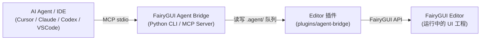

# FairyGUI Agent Bridge

用自然语言，让 AI 直接操作 FairyGUI Editor。

FairyGUI Agent Bridge 在 FairyGUI Editor 和 AI 编程助手之间架了一座桥。通过 MCP 或 CLI，Cursor、Claude Code、Codex、VS Code 中的 Agent 可以读取工程结构、创建和修改界面、制作动效、导入资源并发布产物。你描述需求，它负责把改动落到编辑器里。

[](https://github.com/Wilson520403/fgui-agent-bridge/actions/workflows/ci.yml)
[](LICENSE)

`v0.8.19` · 队列协议 `1.0` · 基于 FairyGUI Editor `6.1.4` 开发与验证

> 本仓库只包含 Bridge 本身。FairyGUI 工程里只安装一个轻量插件，MCP/CLI 始终从本仓库运行。如果使用支持 Skill 的 Agent，还可以额外安装 Skill，让 AI 更熟悉 FairyGUI 的操作约定。

---

## 它能做什么

- **拼界面**：新建组件和按钮，插入已有资源，调整位置、尺寸、样式、布局与控制器。
- **导入资源**：从本地导入图片、字体、声音，或用图片序列生成 MovieClip 动画。
- **做动效**：读取、创建和修改 Transition，支持全部原生轨道，可逐关键帧调整，也能在编辑器里直接预览。
- **整理资源关系**：替换图片引用，查询「谁引用了它」和「它依赖了谁」。
- **分支协作**：列出、创建和切换工程分支，让试验性的改动落在独立目录里，不影响主干。
- **验证改动**：保存后比对文档与磁盘 XML，确认内容真的写进去了。
- **发布**：按活动包、指定包或全部包发布，并在发布前按真实图集约束处理大图。

---

## 工作原理



Agent 与 Bridge 之间通过 MCP stdio 或 CLI 通信；Bridge 把请求写入目标工程的 `.agent/` 目录，Editor 插件轮询队列并调用 FairyGUI 原生 API 执行。所有改动都发生在真实的 Editor 会话里，你在编辑器界面中能立即看到结果。

---

## 环境要求

- Python `3.10+`
- [uv](https://docs.astral.sh/uv/) 包管理器
- FairyGUI Editor（推荐 `6.1.4`）

---

## 安装

### 方式一：让 AI 帮你安装（推荐）

把下面的提示词发给你常用的 AI 编程助手（Cursor、Claude Code、Codex 等）：

```text
请帮我在这台电脑上安装 FairyGUI Agent Bridge，并完成连接验证。
你可以执行终端命令和编辑本地文件，请直接动手安装，遇到需要我确认的地方再停下来问我。

源仓库：https://github.com/Wilson520403/fgui-agent-bridge.git
目标 FairyGUI 工程：优先从当前工作区自动查找 .fairy 文件；找不到或找到多个时先问我。
目标代码仓库：当前工作区。
```

### 方式二：手动安装

#### 1. 克隆仓库并准备环境

```bash
git clone https://github.com/Wilson520403/fgui-agent-bridge.git
cd fgui-agent-bridge
uv sync --frozen
```

#### 2. 安装 FairyGUI Editor 插件

运行同步脚本，在弹出的窗口中选择你的 FairyGUI 工程目录：

```bash
uv run python scripts/sync_to_project.py --choose-project --apply
```

也可以直接用命令行指定工程路径：

```bash
uv run python scripts/sync_to_project.py \
  --project /ABSOLUTE/PATH/TO/FAIRYGUI-PROJECT \
  --apply
```

插件会安装到目标工程的 `plugins/agent-bridge/`。安装完成后重新打开 FairyGUI 工程，插件才会加载。

工程内会自动生成 `.agent/` 运行时目录（请求队列与日志），建议把它加入 `.gitignore`。

#### 3. 配置 MCP Server

根据你使用的 AI 客户端添加 MCP 配置。通用格式如下（示例文件见 [.mcp.example.json](.mcp.example.json)）：

```json
{
  "mcpServers": {
    "fgui": {
      "command": "uv",
      "args": [
        "run",
        "--project",
        "/ABSOLUTE/PATH/TO/fgui-agent-bridge",
        "fgui-agent-mcp"
      ],
      "env": {
        "FGUI_PROJECT_PATH": "/ABSOLUTE/PATH/TO/FAIRYGUI-PROJECT"
      }
    }
  }
}
```

常见客户端的配置入口：

- **Cursor**：`~/.cursor/mcp.json` 或项目根目录的 `.cursor/mcp.json`。
- **Claude Desktop**：`claude_desktop_config.json`（macOS: `~/Library/Application Support/Claude/`，Windows: `%APPDATA%\Claude\`）。
- **Codex CLI**：
  ```bash
  codex mcp add fgui \
    --env FGUI_PROJECT_PATH=/ABSOLUTE/PATH/TO/FAIRYGUI-PROJECT \
    -- uv run --project /ABSOLUTE/PATH/TO/fgui-agent-bridge fgui-agent-mcp
  ```
- **VS Code (Cline / Roo Code)**：在扩展的 MCP Settings 中添加名为 `fgui` 的 stdio 服务。

#### 4. 验证连接

启动 FairyGUI Editor 并打开目标工程，然后执行：

```bash
uv run --project /ABSOLUTE/PATH/TO/fgui-agent-bridge \
  fgui-agent --project /ABSOLUTE/PATH/TO/FAIRYGUI-PROJECT ping
```

返回 `{"status": "ok", ...}` 就说明连接成功了。

### 可选：安装 Agent Skill

Skill 记录了 FairyGUI 的属性规范、动画约定和各工具的用法，能让 AI 少走弯路。可以用同步脚本把它安装到你的业务代码仓库：

```bash
uv run python scripts/sync_to_project.py \
  --project /ABSOLUTE/PATH/TO/FAIRYGUI-PROJECT \
  --skill-root /ABSOLUTE/PATH/TO/YOUR-CODE-REPOSITORY \
  --apply
```

也可以手动把 `.agents/skills/fgui-agent-bridge/` 复制到目标仓库的 `.agents/skills/` 下。

---

## 试试这些指令

安装完成后，在支持 MCP / Skill 的 AI 对话框里直接描述需求即可：

- `帮我制作一个登录界面，包含账号输入框、密码输入框和登录按钮`
- `根据蓝湖 MCP 导出的切图帮我拼出这个背包界面`
- `帮我给 MainMenu 界面的 StartBtn 添加一个弹出的缩放动画效果`

安装了 Skill 的话，也可以用 `/fgui-agent-bridge 帮我制作一个登录界面` 显式触发。

---

## 更新

一条命令即可拉取最新代码、同步 Python 环境，并把新版插件与 Skill 刷新到目标工程：

```bash
uv run python scripts/sync_to_project.py \
  --pull \
  --project /ABSOLUTE/PATH/TO/FAIRYGUI-PROJECT \
  --skill-root /ABSOLUTE/PATH/TO/YOUR-CODE-REPOSITORY \
  --apply

# 或通过 CLI 的 update 子命令
uv run fgui-agent --project /ABSOLUTE/PATH/TO/FAIRYGUI-PROJECT update --pull --apply
```

更新插件文件后需要重新打开 FairyGUI 工程。只有 Bridge 仓库路径或启动命令发生变化时，才需要更新 MCP 配置。

`fgui_status` 会比对 Bridge 与编辑器中插件的版本，不一致时返回 `updateWarning`。

---

## 常用 CLI

在本仓库根目录执行；也可以在任何位置通过 `--project PATH` 指定工程：

```bash
# 状态与连接检查
uv run fgui-agent status
uv run fgui-agent ping

# 查看工程与资源结构
uv run fgui-agent packages
uv run fgui-agent tree

# 分支
uv run fgui-agent branches
uv run fgui-agent create-branch feature-login --switch
uv run fgui-agent items Package1 --branch feature-login
uv run fgui-agent switch-branch ""   # 空名称表示主干

# 查找冗余资源
uv run fgui-agent find-unused
uv run fgui-agent find-unused --skip-exported --type image
uv run fgui-agent find-duplicate

# 保存与发布
uv run fgui-agent save
uv run fgui-agent insert-text --text "Hello" --x 40 --y 520 --name title \
  --style '{"fontSize":28,"color":"#FFCC00","bold":true,"strokeSize":2,"strokeColor":"#FF0000","shadowX":1,"shadowY":2}' --save
uv run fgui-agent publish --scope active
```

更多命令与参数见 `uv run fgui-agent --help`。`call` 仅用于调试原始 Action，日常操作请使用正式子命令。

---

## MCP 工具一览

共 63 个工具，按用途分组：

| 类别 | 工具名称 | 功能描述 |
| :--- | :--- | :--- |
| **连接与定位** | `fgui_status`、`fgui_ping`、`fgui_use_project`、`fgui_get_project`、`fgui_list_packages`、`fgui_list_items` | 检查连接状态、切换工程、查看包列表与包内资源（`fgui_list_items` 可指定 `branch`） |
| **分支** | `fgui_list_branches`、`fgui_create_branch`、`fgui_switch_branch` | 列出、创建和切换工程分支，切换后读写都会落在对应分支 |
| **文档与对象** | `fgui_open_document`、`fgui_get_active_document`、`fgui_get_tree`、`fgui_select_object`、`fgui_insert_object`、`fgui_insert_text`、`fgui_set_property`、`fgui_remove_object` | 打开组件、查看对象树、选中元件、修改属性及增删显示对象；`fgui_insert_text` 创建文本对象（0.8.20+） |
| **资源创建/导入** | `fgui_create_component`、`fgui_create_button`、`fgui_import_image`、`fgui_import_font`、`fgui_import_sound` | 新建组件/按钮，从本地绝对路径导入图片、字体与声音 |
| **MovieClip 序列帧** | `fgui_create_movieclip`、`fgui_get_movieclip`、`fgui_update_movieclip`、`fgui_remove_movieclip` | 从本地图片序列创建或更新序列帧动画（帧直接嵌入 `.jta`） |
| **Transition 动效** | `fgui_list_transitions`、`fgui_get_transition`、`fgui_verify_transition`、`fgui_upsert_transition`、`fgui_remove_transition`、`fgui_add_transition_item`、`fgui_update_transition_item`、`fgui_remove_transition_item`、`fgui_add_keyframes`、`fgui_set_keyframe`、`fgui_duplicate_transition` | 读取与校验动效，声明式增改整段动效，原子化修改条目或关键帧，复制整条 Transition |
| **动画预览** | `fgui_preview_animation` | 在编辑器中实时播放、暂停、停止、跳帧预览 Transition 或 MovieClip |
| **保存与事务** | `fgui_get_history`、`fgui_undo`、`fgui_redo`、`fgui_save_document`、`fgui_save_all`、`fgui_discard_document` | 撤销/重做、保存文档或放弃未保存修改 |
| **验证与资源引用** | `fgui_verify_document`、`fgui_replace_object_resource`、`fgui_replace_references`、`fgui_query_references`、`fgui_query_dependencies`、`fgui_get_text_style`、`fgui_set_text_style` | 比对预期属性或整个对象树、替换资源引用、查询引用图、读写文本样式（0.8.20+ 支持 `bold`/`italic`/`underline`/`strokeSize`/`strokeColor`/`shadowX`/`shadowY`/`shadowColor`） |
| **冗余资源** | `fgui_find_unused`、`fgui_find_duplicate` | 找出没有被引用的资源，以及内容完全重复的文件（只读） |
| **布局与控制器** | `fgui_set_list_layout`、`fgui_set_group_layout`、`fgui_set_relation`、`fgui_set_gear_display`、`fgui_list_controllers`、`fgui_set_controller` | 修改 List/Group 布局、替换 Relation 绑定、设置 gearDisplay 联动、增删改 Controller |
| **图集与发布** | `fgui_get_publish_settings`、`fgui_set_publish_settings`、`fgui_analyze_atlas_fit`、`fgui_clear_atlas_markers`、`fgui_publish` | 查询或修改发布设置、判断图片能否放进图集、修正图集标记、执行资源发布 |

---

## 使用说明与注意事项

### 写入、验证与撤销

大多数写操作支持 `save`、`verify` 和 `external_reload` 三个选项（新建组件、删除组件等少数操作不支持 `external_reload`）：

- `save`：执行后立即保存文档。
- `verify`：重新读取对象树，并按需比对磁盘 XML。
- `external_reload`：重新加载文档或资源后再比对，是最强的持久化验证（需要同时设置 `save=true`）。

响应里的 `persisted` 和 `strength`（`reload` / `disk` / `none`）会告诉你验证到了哪一层。

属性修改和 Transition 编辑会进入 Agent 撤销栈，可以用 `fgui_undo` / `fgui_redo` 回退。结构创建、删除和资源导入不属于可逆操作；`discard` 只放弃当前文档未保存的修改，不能替代 `undo` 或 `save`。

### 查找冗余资源

- `fgui_find_unused` 会沿着引用关系，找出工程里没有被任何地方引用的资源，返回包名、路径、大小，图片还带尺寸。导出资源默认也会列出来并标记 `exported=true`，因为运行时可能按 URL 直接加载它们；确认不需要后，可以用 `skip_exported=true` 把它们排除。
- `fgui_find_duplicate` 按文件内容分组，找出完全相同的图片、字体、音效和组件 XML，并按浪费的空间从大到小排序，方便优先清理大头。同名但内容不同不算重复。
- 两个工具都是只读的，不会改动或保存工程。可以用 `packages` / `types` 缩小范围，传 `include_branches=false` 只看主干。编辑器自带的同类功能需要 Pro 授权，Bridge 的实现不依赖它，装好就能用。

### 改资源引用之前

- `fgui_query_references` 查「谁引用了这个资源」，`fgui_query_dependencies` 查「这个资源依赖了谁」。两者都是只读的，不会修改文档。
- 单个对象换图用 `fgui_replace_object_resource`，支持 Image 和 Loader，可撤销、可验证。Button 的状态图替换不在支持范围内。
- 全工程批量换图用 `fgui_replace_references`。它**默认只预览**，确认 `totalCount` 和明细后再传 `execute=True`。执行后立即落盘、不进入 Agent 撤销栈，调用前请确认这是你想要的。替换完成后建议按引用图再查一次，确认源资源的残留引用为 0。

### 分支

- 用 `fgui_list_branches` 查看现有分支，`fgui_create_branch` 新建，`fgui_switch_branch` 切换（传空名称回到主干）。创建和切换都会立即写入磁盘、不能撤销；默认不处理已打开的文档，需要时传 `save_open_documents=true`。
- 读写工具省略 `branch` 时跟随当前活跃分支，传 `branch=""` 明确表示主干。支持 `branch` 的读取工具可以直接指向任意分支，写入则要求目标分支正处于活跃状态，避免改动落到错误的地方。分支资源放在 `assets_<branch>/<包名>/` 下，不会混进主干的 `package.xml`。
- 在 FairyGUI 6.1.4 上，保存仍然跟着文档本身：分支文档需要对应分支活跃时才能保存，主干文档在分支活跃时也会拒绝保存。切换前先保存并关闭文档，可以少走弯路。`fgui_replace_references` 和 `fgui_clear_atlas_markers` 只支持主干，分支活跃时会被拒绝。
- 重启编辑器后会回到主干，但分支内容都还在磁盘上，用 `fgui_switch_branch` 切回去就能继续。

### 动效

- Transition 覆盖全部 FairyGUI 原生轨道，时间单位是帧。`fgui_upsert_transition` 适合声明式地创建或整段替换动效；`fgui_add_keyframes`、`fgui_set_keyframe` 适合局部调整关键帧。
- `fgui_verify_transition` 是只读检查：它会验证目标对象、轨道兼容性、关键帧取值范围、嵌套 Transition / Sound 引用、Tween 端点和画面范围。`errors` 表示确定有问题，`warnings` 则可能是设计意图（例如滑入/滑出动画里坐标超出画布）。校验不会修改文档，也不会把文档标记为已修改。
- 关键帧的 `tween=true` 只能续接已经处于 Tween 关系中的帧。要在两个普通关键帧之间建立 Tween，或者延长已有 Tween，请用 `fgui_upsert_transition` 重建。
- `fgui_preview_animation` 只影响编辑器里的预览状态，不会保存为资源属性。
- MovieClip 的帧会直接嵌入 `.jta`，不会在包内生成散图资源。删除 MovieClip 需要显式传 `force=true`，并且会先检查引用；全新创建和删除无法撤销。

### 图集与发布

- `fgui_analyze_atlas_fit` 按图集打包器的真实约束（包级 `PackSettings` 或全局 `AtlasSetting`）判断每张图能否放进图集，不再依赖猜测。`fit=unknown` 表示约束信息不足，不代表通过。`summary.assignedAloneButFits` 可以帮你发现磁盘上被标成 `alone`、但实际装得下的图片。
- `fgui_import_image` 和 `fgui_publish` 使用与 `fgui_analyze_atlas_fit` 相同的判定逻辑，所以「分析说装得下、导入却标了 alone」不会发生。执行结果会放在 `atlasAssignment` 里，说明这次是写入了标记、已有标记无需重复写入，还是因为约束不足没有下结论。
- 包内已有图片的 `atlas` 标记没法通过编辑器 API 改掉。分析报出 `alone-not-needed` 时，可以用 `fgui_clear_atlas_markers` 修正：它默认只预览，确认后再执行。这个工具会直接写 `package.xml`，执行前自动备份，写入后重新加载包检查结果；该操作不可撤销，执行前请先关闭这些包里的文档（或允许 Bridge 代为关闭已保存的文档）。
- `fgui_set_publish_settings` 修改包级发布与图集设置。它只写你显式提供的字段，`atlasList` 是全量替换语义；`atlasList` 不能传空数组（FairyGUI 6.1.4 会报错并影响该包后续保存）；`padding`、`square` 等部分 `packSettings` 字段无法跨编辑器重启保留，这类设置建议直接在编辑器界面里改。
- 发布期间 Bridge 会封锁大部分写操作。发布前先调 `fgui_get_publish_settings` 确认输出目录与图集配置，发布后检查返回的文件变更清单。

### 连接与运行时

- 使用时 FairyGUI Editor 必须保持运行并打开目标工程。
- `.agent/` 是工程内的运行时队列与日志，不属于安装文件，不要提交到 Git。
- 插件会忽略超过 60 秒未被认领的请求，并在启动时清理残留队列。客户端超时并不代表操作没有执行，重试前请先用 `fgui_status` 或 `fgui_get_active_document` 确认当前状态，避免重复写入。
- 图片、字体、声音和 MovieClip 的导入路径必须是绝对路径。导入和替换都是磁盘写入，不受 `discard` 影响。

---

## 常见问题与排错

| 异常现象 | 可能原因 | 解决办法 |
| :--- | :--- | :--- |
| `ping` 超时或提示未连接 | FairyGUI Editor 未启动；目标工程未打开；插件未安装或未生效 | 打开 Editor 并加载工程；确认 `plugins/agent-bridge/main.js` 存在；重新打开工程加载插件；查看 `.agent/bridge.log` |
| MCP 客户端找不到工具 | MCP 配置里的绝对路径错误；客户端未重新加载 | 检查配置中的仓库路径和工程路径；新建对话或重启 IDE |
| 导入资源失败 | 传了相对路径，或文件不存在 | 使用本地绝对路径重新导入 |
| 发布卡住或超时 | 发布正在进行；同时调用了其他写操作 | 发布期间不要并发写入，等待完成后查看发布日志 |
| 图集分析结果为 `unknown` | 包级或全局约束缺少页尺寸等信息 | 补全 `PackSettings` / `AtlasSetting` 后重新分析，或到编辑器设置中确认图集配置 |

---

## 兼容性与已知限制

- **FairyGUI 版本**：以 `6.1.4` 为主要开发和验证版本，其他 6.x 版本尚未做完整验证。
- **动画类型**：专注 FairyGUI 原生 Transition 与 MovieClip，不支持 Spine、DragonBones、Loader3D、SWF 等第三方动画格式。
- **资源管理**：暂不提供通用的包内资源重命名与跨包移动；MovieClip 删除需要显式确认并做引用检查。
- **平台**：macOS 已完成端到端验证；Windows 也可以使用，但尚未做完整的实机验证，遇到路径或兼容问题欢迎提 Issue。

---

## 开发与维护

- 插件 TypeScript 源码：`plugin/main.ts`
- 插件运行时文件：`plugin/main.js`
- Python MCP & CLI：`src/fairygui_agent/`
- Agent Skill：`.agents/skills/fgui-agent-bridge/`
- 同步脚本：`scripts/sync_to_project.py`

修改 `plugin/main.ts` 后必须重新编译并提交 `plugin/main.js`。版本升级时，请同步更新 `plugin/package.json`、`pyproject.toml`、`src/fairygui_agent/__init__.py`、`plugin/main.ts` 和 `plugin/main.js`。

推荐在提交前运行：

```bash
uv lock
uv sync --frozen
uv run python -m compileall -q src scripts
uv run python -m unittest discover -s tests -v
npx -y -p typescript@5.4.5 tsc -p plugin/tsconfig.json --pretty false
git diff --check
```

---

## 相关生态

- [蓝湖 MCP (lanhu-mcp)](https://github.com/dsphper/lanhu-mcp)：配合本工具，可以让 AI 编程 Agent 自动从蓝湖设计稿下载切图、导出标注，并直接在 FairyGUI 中拼装 UI 并发布。

---

## 许可证

[MIT License](LICENSE)
